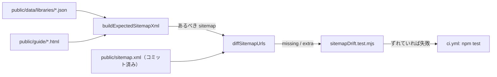

# 設計: sitemap.xml の作り直し忘れを CI で検知する（#193）

## Architecture Overview

## Component Design

### `scripts/generateSitemap.mjs`（追加）

- `export function extractSitemapUrls(xml)`: `<loc>…</loc>` の中身（XML エスケープを戻したもの）を集合で返す。
- `export function diffSitemapUrls(committedXml, expectedXml)`: `{ missing, extra }`（どちらも名前順の配列）。`missing` はあるべきなのにコミット済みに無い URL、`extra` はその逆。
- `export async function buildExpectedSitemapXml()`: 実際の生成元（`LIBRARIES_DIR`・`GUIDE_DIR`）から `buildSitemapXml` で作る。lastmod は比較に使わないため固定値。`writeSitemap` もこれを使うように整理する（生成の手順を1か所にする）。

### `scripts/sitemapDrift.test.mjs`（新規）

- `public/sitemap.xml` を読み、`buildExpectedSitemapXml()` と `diffSitemapUrls` で比べる。
- ずれていれば、足りない URL・余分な URL（各10件まで＋件数）と作り直しのコマンドを載せたメッセージで失敗させる。

### テスト（`generateSitemap.test.mjs` に追加）

- `extractSitemapUrls`: `<loc>` を集合で返し、`&amp;` などを戻す。
- `diffSitemapUrls`: 過不足なし／足りない／余分を返す。lastmod・priority の違いは無視する。

## Data Flow

上図のとおり。

## Domain Models

なし。
